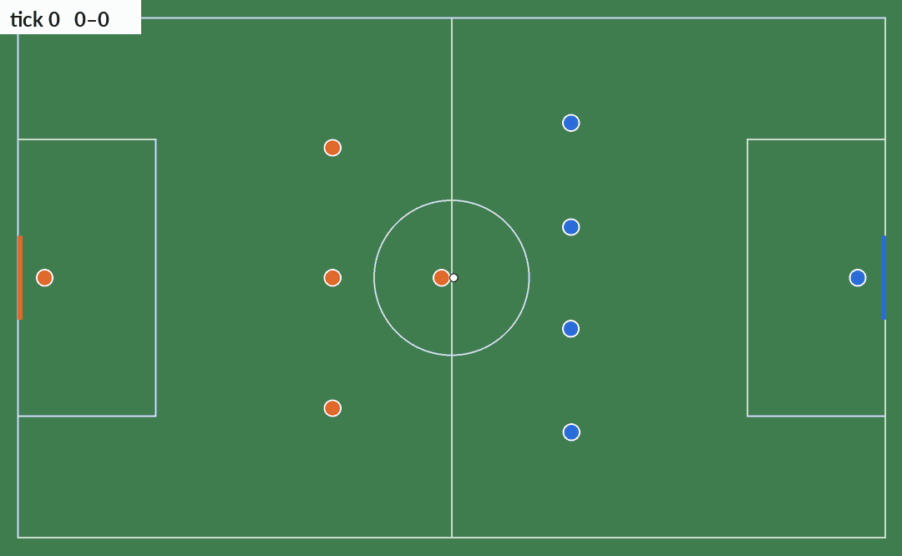
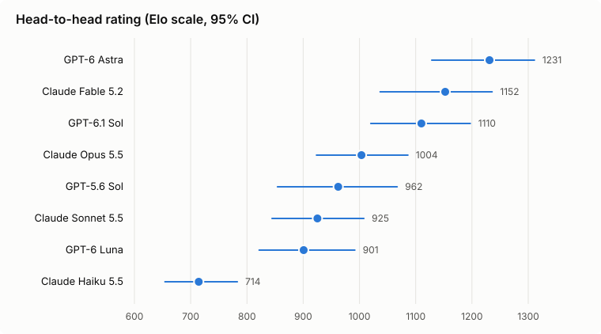
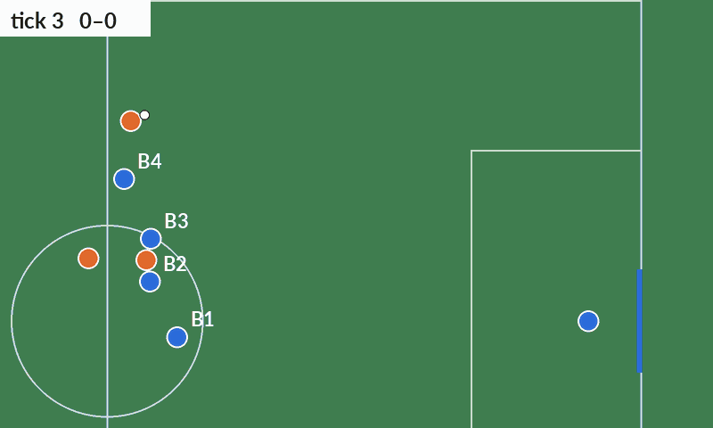
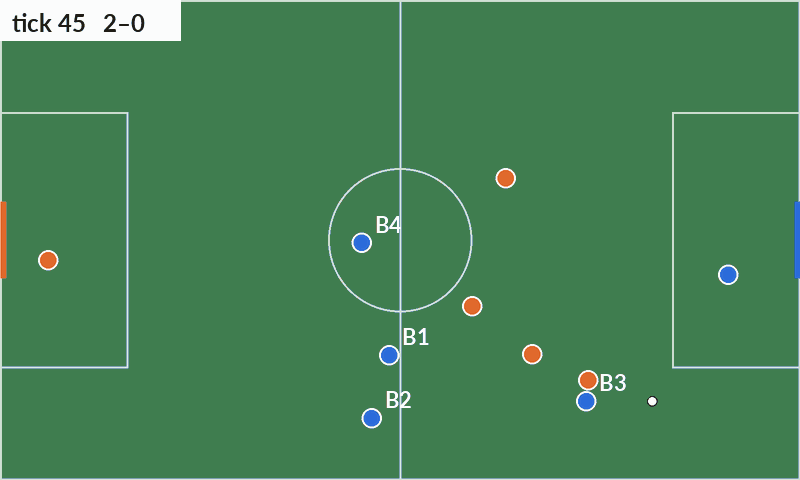
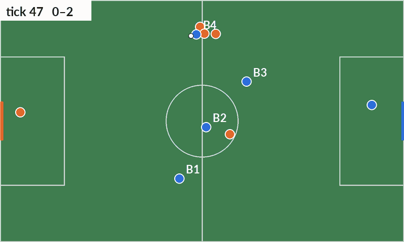
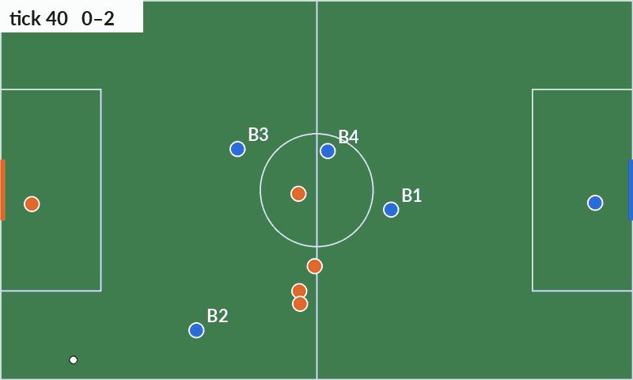

# ⚽ Soccer-Bench

Soccer-Bench measures how well language models coordinate as a team. Two teams of five play 2D
soccer, and every player is a separate model call: each tick, all ten players independently move,
pass or stay, and can shout a short message to their teammates. Strong models divide the work;
weak ones swarm the ball like children.

<p align="center">
  
  <br>
  <sub>A full game, replayed from the logs: GPT-6 Astra (orange) 2–1 GPT-6.1 Sol (blue). Every dot
  is a separate model call each tick.</sub>
</p>

<p align="center">
  <a href="https://darksinian.github.io/soccer-eval/"><b>Live site: leaderboard and every game</b></a>
  &nbsp;·&nbsp; <a href="https://darksinian.github.io/soccer-eval/writeup.html">Findings</a>
  &nbsp;·&nbsp; <a href="#leaderboard">Leaderboard</a>
  &nbsp;·&nbsp; <a href="#quickstart">Run it</a>
</p>

## Leaderboard

8 models, 58 games, five-a-side, shouting on, every model playing the others from both sides of
the pitch at its provider's default reasoning effort.



| # | Model | Rating (95% CI) | W-D-L | Cost per game |
|---|---|---|---|---|
| 1 | GPT-6 Astra | 1231 (1128–1311) | 12-0-1 | $5.86 |
| 2 | Claude Fable 5.2 | 1152 (1037–1236) | 5-0-1 | $14.16 |
| 3 | GPT-6.1 Sol | 1110 (1020–1197) | 11-0-5 | $1.31 |
| 4 | Claude Opus 5.5 | 1004 (924–1086) | 8-2-7 | $4.23 |
| 5 | GPT-5.6 Sol | 962 (854–1067) | 6-0-7 | $5.31 |
| 6 | Claude Sonnet 5.5 | 925 (845–1008) | 5-3-7 | $2.07 |
| 7 | GPT-6 Luna | 901 (822–992) | 7-2-11 | $0.14 |
| 8 | Claude Haiku 5.5 | 714 (654–783) | 0-1-15 | $0.12 |

Bradley–Terry ratings on the Elo scale with 1,000-resample bootstrap intervals. Full stats,
head-to-head and every shout are in [`results/`](results/standings.md).

**Key findings** (details, with links to every game, in the [writeup](https://darksinian.github.io/soccer-eval/writeup.html)):

- **Weak teams swarm the ball instead of splitting the work.** Haiku sends 2+ players at the ball
  on 62% of the opponent's possession, Luna on 49%; the top five on 15–26%.
- **Price doesn't predict rank.** GPT-6.1 Sol is third at $1.31 a game; GPT-5.6 Sol costs four
  times as much and is fifth.
- **Talking seems to help the strong model, not the weak ones.** GPT-6.1 Sol's talking side beat
  its silent self 6–2–2; Haiku and Luna went 3–0–3 either way. Preliminary: 6–10 games each.
- **Told a formation, weak teams hold it, but it doesn't reliably make them win.**

| | |
|---|---|
|  |  |
| **1. Swarming.** All four Haiku players chase one carrier; GPT-6.1 Sol walks it in. | **2. Announcing.** Sol's B4 calls "Attacking far-post lane (84,35)"; B2 passes to (85,35) and B4 scores. |
|  |  |
| **3. Passing into a run.** Astra's B4 plays into the space ahead of B1, who was already running; B1 scores. | **4. Someone home.** Sol's B1 holds the centre circle "guarding against a counter" while three attack. |

## How it works

Each tick, every player (goalkeeper included) gets the same snapshot of the field and makes its own
call to its team's model, all at once; nobody sees anyone else's decision. A player can move, pass
or stay, and shout up to 80 characters that its teammates hear on the next tick. Shouts are the only
memory a player has.

Single-agent harnesses (Claude Code, Codex, mini-SWE-agent) can't run ten simultaneous players, so
Soccer-Bench ships its own runner ([`run.py`](run.py)). Every game log records each player's exact
action per tick, and [`soccer_eval/verify.py`](soccer_eval/verify.py) replays it to re-check the
score: all 58 leaderboard games agree.

## Quickstart

```bash
pip install -e .
export OPENROUTER_API_KEY=...
python run.py --team1 openai/gpt-6.1-sol --team2 anthropic/claude-haiku-5.5 \
  --n 5 --max-ticks 60 --comms team --games 2
```

This plays two games (sides swap) with the leaderboard settings and writes each game's log and a
replay you can open in a browser to `runs/latest/`. All flags are in [docs/running.md](docs/running.md).

**Rebuild the leaderboard and site** from the logs in [`runs/leaderboard/`](runs/leaderboard):

```bash
python scripts/leaderboard.py    # re-checks every game, writes results/
python scripts/build_site.py     # writes site/
```

**Add a model:** play it against several leaderboard models with the settings above, copy each
`game_XX.json` into `runs/leaderboard/` under a new name, add its display name to `NAMES` in
[`soccer_eval/games.py`](soccer_eval/games.py), and rebuild.

**Develop:** `python -m pytest` and `mypy` (strict) both pass.

## Layout

- `soccer_eval/`: the game: simulator, prompts, model players, match runner,
  verifier, typed log schema
- `run.py`: plays a series between two teams
- `scripts/`: leaderboard, team-play metrics, hand-labelled shouts, experiments, charts, site builder
- `runs/leaderboard/`, `runs/experiments/`: one log per game
- `results/`: ratings, head-to-head, all shouts, the shout labels
- `site/`: the static replay site
- `docs/`: [writeup](docs/writeup.md), [running games](docs/running.md)

## Citation

```bibtex
@software{otefi2026soccerbench,
  title  = {Soccer-Bench: Measuring Multi-Agent Coordination in Language Models through Soccer},
  author = {Otefi, Mohamed},
  year   = {2026},
  url    = {https://github.com/Darksinian/soccer-eval}
}
```

## License

[MIT](LICENSE).
