# Soccer-Bench: Findings

*Everything here is measured from the game logs in [`runs/`](../runs); the [README](../README.md)
has the leaderboard and how to run the benchmark.*

## Motivation

In the DeepMind Institute essay [*The Economics of Intelligence: How and when does AGI lead to economic transformation?*](https://institute.deepmind.com/essays/the-economics-of-intelligence/), Imas, Koh, and Legg argue that one reason the economy has remained relatively unchanged despite the explosion in model capabilities is the difficulty of coordinating multiple agents. They argue that "[o]nce coordination reaches a critical threshold, it triggers large, abrupt jumps in market concentration, employment, and wages." Most capability benchmarks focus on individual agents, whereas the relevant economic unit is often the organization. The authors rightfully argue that we need benchmarks that examine how agents communicate, divide responsibilities, and coordinate toward shared objectives. This benchmark is a loose first attempt to measure some of these capabilities in a familiar setting.

When kids first start playing soccer, they tend to chase the ball together with little regard for positioning or strategy. As they improve, some structure begins to emerge where players hold positions, make passes, and start anticipating movements. At the pro level, teams exhibit sophisticated coordination with little explicit communication. Soccer is particularly interesting because it requires several forms of coordination:

1. **Off-ball coordination:** Players spend most of their time without the ball. They make runs, occupy space, draw defenders away, and create plays for their teammates. Lots of contributions on the field are made by players who never touch the ball during the play.

2. **Implicit coordination:** Through positioning and movement, players communicate intentions without explicitly stating them. Think of a perfectly timed through-ball or the passing sequences of Barcelona's tiki-taka. If you've ever watched the golden generations of Brazil play, you know how beautiful it can be when players have shared chemistry without exchanging a single word.

3. **Explicit communication:** Players shout calls for passes and signal movements that help organize plays on the field. These messages can help synchronize actions when intentions can't be inferred from positioning alone.

4. **Adaptation and replanning:** Soccer is very dynamic. A pass can be intercepted, a defender can change positions, or an unexpected opening can emerge. Players have to be adaptive and continuously adjust their decisions while maintaining a degree of collective structure.

This coordination doesn't always require prior planning. A group of strangers will typically show up for a pickup game, and within minutes begin developing something resembling an organized team. Players implicitly assume roles, adjust to each other's tendencies, and gradually improve their collective behavior.

**Can LLM agents do something similar?**

More specifically, can agents spontaneously develop roles, anticipate their teammates, communicate useful information, and adapt their strategies without centralized planning?

Soccer offers a relatively simple environment to observe these behaviors. It is a setting in which agents must repeatedly make decisions toward a shared objective. The hope is that studying their behavior can offer some useful insights into how we might design better multi-agent coordination benchmarks.

## Setup

Two teams of five play 2D soccer on a 100 × 60 pitch, for 60 ticks (one simulated second each) or until a team scores three goals.

Every player, including the goalkeeper, is controlled by a separate call to its team's model. At each tick:

1. Players receive the same snapshot of the pitch: every player's position and last movement, the ball, the score and the time left, and any shouts in the previous tick, with no memory of earlier ticks.
2. Each player independently chooses one of the following actions: move toward a point, pass toward a point or stay in place. Shooting is just a pass toward the opponent's goal. They can also shout a message of up to 80 characters, which all teammates receive in the next tick.

Passes travel in straight lines and bounce off the pitch boundaries until intercepted or received. Players physically block one another, and opponents can win possession by touching the ball, making positioning and defensive coordination important. Models compete using their providers' default reasoning effort.

**There is no planning phase and no assigned positions apart from the goalkeeper. Roles, formations, and collective strategies emerge during play.**

## Findings

### 1. Weak teams swarm the ball

When an opponent has possession, how often do two or more defenders decide to chase the ball instead of covering other players or occupying space?

Figure 1 shows this for each model, ordered by leaderboard ranking.

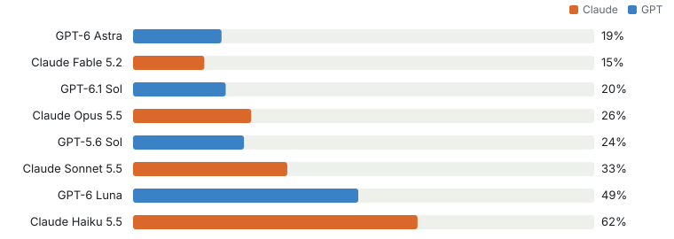

*Figure 1. Share of the opponent's possession ticks on which two or more outfield players head for the ball. Teams in rating order, strongest first.*

The three models that swarm the ball the most also happen to be the bottom three teams on the leaderboard. The top five, by comparison, stay between 15% and 26%. In other words, weaker models behave like kids when they first start playing soccer. They run towards the ball, leaving the rest of the pitch wide open for possible attacks. Rather than coordinating defensive responsibilities across the field, weaker models assign themselves the same job. In one tick against GPT-5.6 Sol, all four Haiku outfield players announce that they're moving to intercept the same ball carrier:

> A1: "cutting in front of B2 at (37,46) to block its path west" 
> A2: "cutting B2's path west at (34,49.5)" 
> A3: "moving to (38,47) to get into B2's path and tackle" 
> A4: "closing B2 from the right side, will tackle if ball comes within reach"

Despite announcing their intentions, they converge on the same player and continue following the carrier instead of spreading out to cover the rest of the field (Figure 2).

[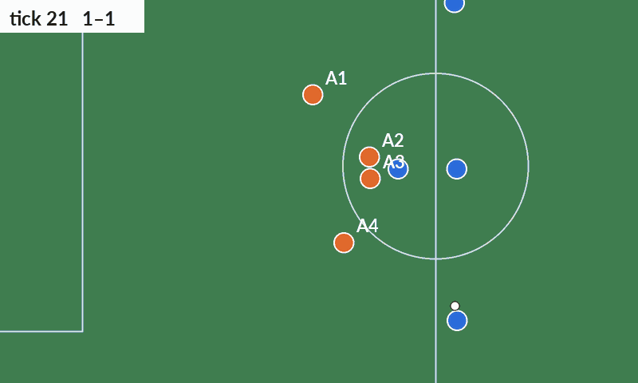](https://darksinian.github.io/soccer-eval/replays/haiku-5-5-vs-gpt-56-sol-home.html?t=21&autoplay)

*Figure 2. Haiku (orange) against GPT-5.6 Sol, ticks 21–27: all four outfield players converge on one carrier. Click the clip to open the full replay.*

Against GPT-6.1 Sol, the same behavior has more immediate consequences (Figure 3). All four Haiku players chase the ball carrier, A2, down the wing, leaving its three teammates unmarked. A2 takes advantage of the open space and scores.

Even Sol's goalkeeper notices what's happening:

> "all four defenders are chasing A2."

Indeed, Sol, indeed.

[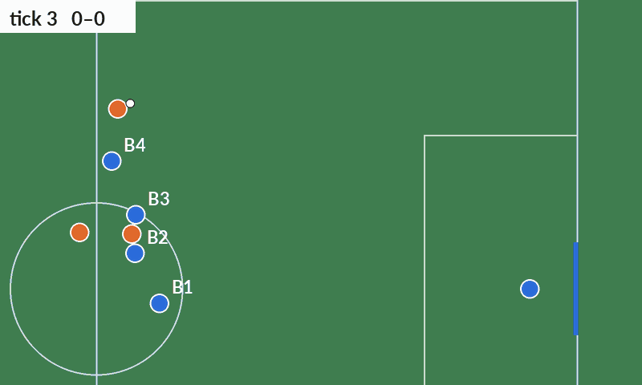](https://darksinian.github.io/soccer-eval/replays/haiku-5-5-vs-gpt-61-sol-away.html?t=3&autoplay)

*Figure 3. GPT-6.1 Sol (orange) against Haiku (blue), ticks 3–9: all four Haiku players chase the carrier A2, and A2 scores.*

The interesting failure here isn't that the defenders make individually unreasonable decisions. Closing down a ball carrier is often the right thing to do. The problem is that **all four players independently decide to do it, without accounting for what their teammates are already doing.**

In other words, reasonable individual decisions can add up to a poor collective strategy.

### 2. Strong teams keep someone home

When a team attacks, does anyone stay behind to defend against a potential counterattack?

Figure 4 measures how often a team keeps an outfield player at least 20 units behind the ball while attacking. The top five teams do this on 12–16% of attacking ticks, compared to just 2–4% for Sonnet, Luna, and Haiku.

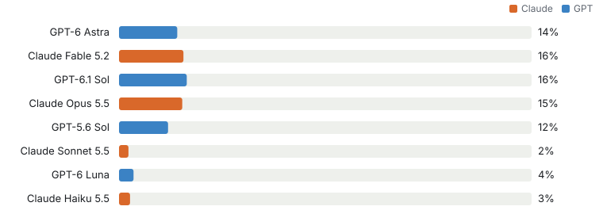

*Figure 4. Share of attacking ticks with an outfield player 20+ units behind the ball.*

What's interesting is that **this defensive role emerges without any pre-assigned positions or centralized planning**. A player will often recognize that someone needs to stay back and volunteer for the job. On Astra, GPT-6.1 Sol, Fable, and Opus, the player holding back explicitly announces its intention 65–100% of the time:

> "Holding central cover behind attack; guarding against a counter"

This is a nice example of spontaneous division of responsibilities. Rather than everyone pursuing the objective of scoring, one player assigns itself to protect the team against a possible loss of possession. When nobody takes on that responsibility, counterattacks can cost the team many goals. Luna and Haiku each conceded 9 goals on counterattacks with nobody back. Astra, by comparison, conceded only 1, and Fable none.

In Figure 5, GPT-6.1 Sol's B1 holds its position near the centre circle while the other three players attack. If possession is lost, there's still someone between the ball and the goal. The team maintains defensive cover without needing an explicitly assigned defender.

[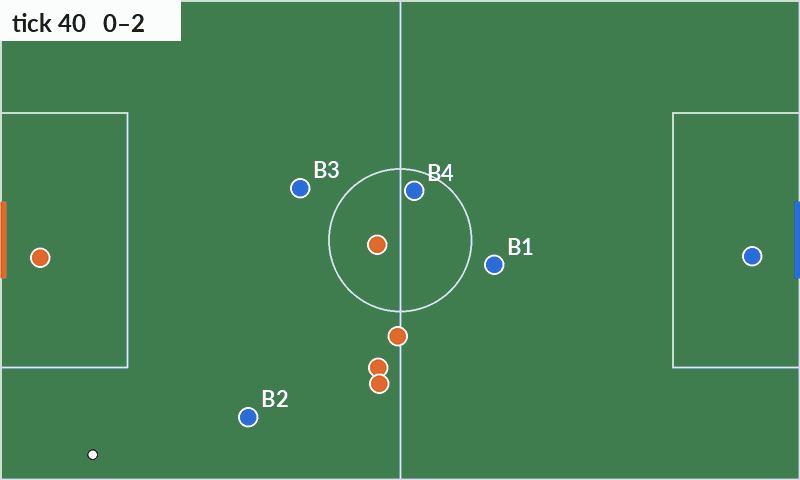](https://darksinian.github.io/soccer-eval/replays/sonnet-5-5-vs-gpt-61-sol-home.html?t=40&autoplay)

*Figure 5. Someone home: GPT-6.1 Sol (blue). B1 holds the centre circle while the other three attack, and B3 scores.*

Figure 6 shows the opposite. All four Luna outfield players push forward, leaving nobody behind. When GPT-5.6 Sol intercepts the ball, there's nothing between its attacker and Luna's goalkeeper. Sol's B4 carries the ball halfway across the pitch and scores.

[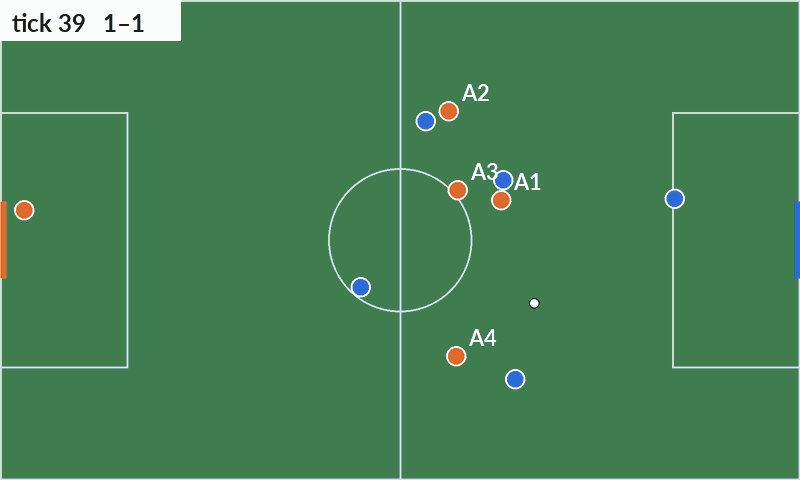](https://darksinian.github.io/soccer-eval/replays/luna-vs-gpt56-sol.html?t=39&autoplay)

*Figure 6. Nobody home: Luna (orange). All four Luna outfield players push into GPT-5.6 Sol's half. Sol intercepts, and B4 carries the ball half the pitch with every Luna player behind it, and scores.*

Stronger teams recognize a responsibility that hasn't been explicitly assigned to anyone and organize themselves to fulfill it.

### 3. Some teams direct each other, others say where they'll be

There are two distinct communication patterns in the traces: every model announces what it intends to do, but some also tell their teammates what to do.

Figure 7 shows how these styles differ across models.

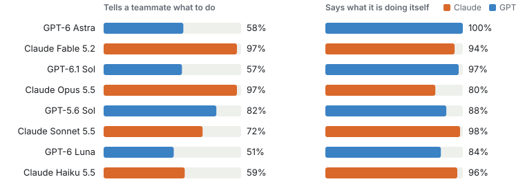

*Figure 7. Share of each team's outfield shouts that tell a teammate what to do and that announce the speaker's own move. Hand-labelled random sample of 100 shouts per model.*

Almost every shout from every model says what the speaker intends to do (80–100%). However, some models tend to order their teammates around: 97% of Opus's and Fable's shouts tell a teammate what to do, against 57–58% for Astra and GPT-6.1 Sol. These differences also appear in how teammates respond. **72% of Opus's and 74% of Fable's passes to a teammate go to one who had just asked for the ball outright, compared to 16% for Astra and 11% for GPT-6.1 Sol. Yet for all four, about 90% of passes go to a teammate who had at least said it was open.**

Astra and GPT-6.1 Sol tend to announce their intended movements, leaving the player with possession to decide how to use that information. Rather than asking for the ball, they communicate where they'll be. Neither approach appears inherently superior. Both styles are represented among the top three teams: Fable (2nd) directs in almost every shout, while Astra (1st) and GPT-6.1 Sol (3rd) direct in just over half.

**Directing: asking for the ball**

In Figure 8, Opus's A1 explicitly asks A4 to pass ahead of its run:

> "open at (65,42) heading to box - A4 pass ahead of me."

On the next tick, A4 plays exactly that pass, and the ball reaches A1.

[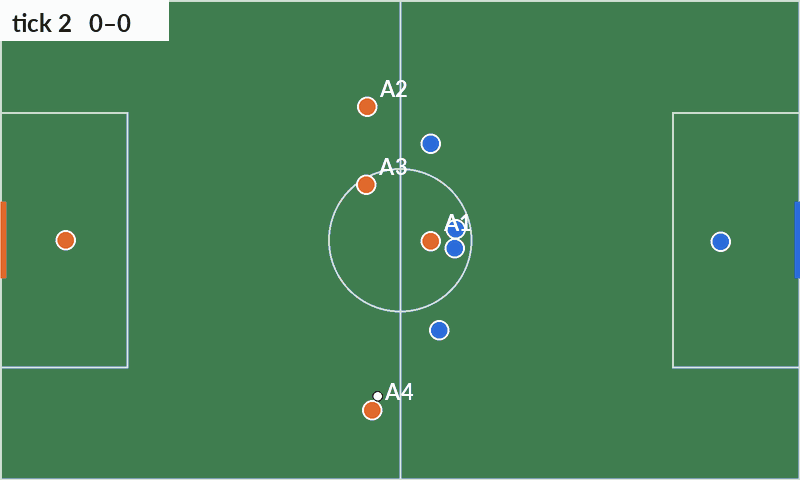](https://darksinian.github.io/soccer-eval/replays/gpt-6-astra-vs-opus-5-5-away.html?t=3&autoplay)

*Figure 8. Directing: Claude Opus 5.5 (orange) against GPT-6 Astra, ticks 2–6. A1 asks for the ball and A4 passes it there.*

**Announcing: communicating intentions**

In Figure 9, during a well-coordinated GPT-6.1 Sol attack, two players position themselves to receive the ball. B1 explicitly asks for a pass, while B4 announces where it intends to run. B2 eventually chooses B4's run rather than following B1's request.

- **Tick 45.** Sol wins the ball back. B4 announces: *"Advancing central to x60 y31; ready for a diagonal through pass."*
- **Tick 48.** B2 collects the ball on the wing. B1 asks: *"B2, diagonal to me near (74,21)."* Meanwhile, B4 announces: *"Attacking far-post lane (84,35)."*
- **Tick 49.** B1 asks again: *"B2, ready inside at (78,24)."* Instead, B2 plays a diagonal pass into B4's announced lane, to (85,35): *"B4: diagonal incoming; meet ball at (85,35) next tick, then finish!"*
- **Ticks 50–51.** B4 collects the pass at the far post and scores.

[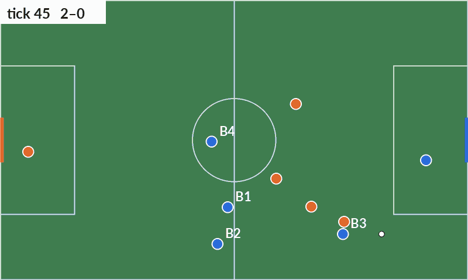](https://darksinian.github.io/soccer-eval/replays/gpt-6-astra-vs-gpt-61-sol-home.html?t=45&autoplay)

*Figure 9. Announcing: GPT-6.1 Sol (blue) against GPT-6 Astra, ticks 45–51. B2 passes into B4's announced run instead of to B1, who asked for the ball, and B4 scores.*

### 4. Strong teams pass into announced runs

Some of the most impressive moments in soccer happen when a player passes into an empty space, knowing that a teammate will arrive there at the right time. We define a *through ball* as a pass aimed at least 5 units away from the nearest teammate, not counting shots. Since the passer and receiver choose their actions simultaneously, neither knows what the other is about to do. 

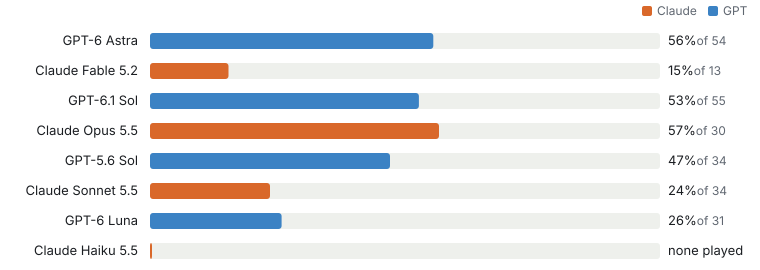

*Figure 10. Share of through balls (passes aimed 5+ units from the nearest teammate, excluding shots) where that teammate was already running to the spot. The number after each bar is how many through balls the team played; Haiku played none.*

Opus, Astra and GPT-6.1 Sol lead at 53–57%, while Sonnet and Luna manage 24–26%. **Haiku never played a single through ball**: every pass it aimed into space was a shot at goal. Across all teams, 85% of through balls into an existing run successfully reach a teammate, compared to 65% of the remaining through balls.

Fable is an interesting exception among the stronger teams. It rarely plays passes into teammates' runs, instead tending to pass to players who explicitly ask for the ball. This is consistent with the more directive communication style we saw in Finding 3.

These runs aren't silent. In 93% of these passes, the receiver announced the run the tick before, saying where it was going or asking for the ball there. Figure 11 shows an example of this coordination pattern. Astra's B1 announces that it's *"open for diagonal pass"*. B4 then plays the ball into the space ahead of B1, who continues its run, receives the pass, and scores.

[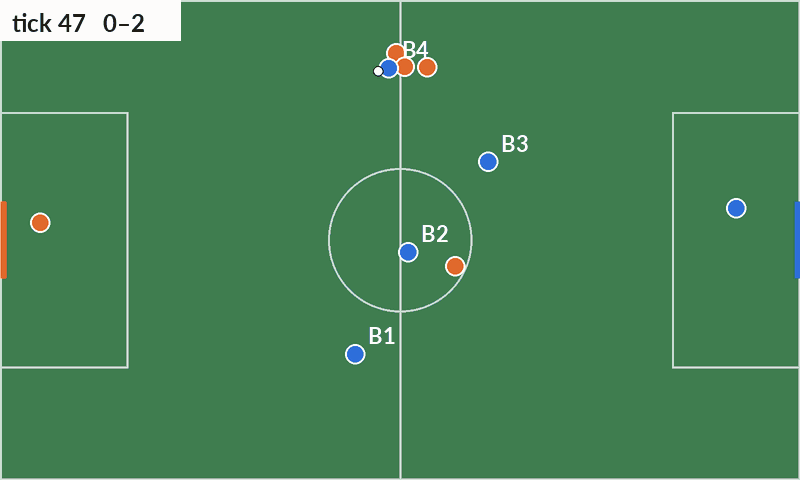](https://darksinian.github.io/soccer-eval/replays/gpt-6-astra-vs-gpt-6-luna-away.html?t=47&autoplay)

*Figure 11. GPT-6 Astra (blue) against Luna, ticks 47–52: B4 plays the ball into B1's run, and B1 scores.*

## Additional Experiments: Do talking and formations help?

The findings so far suggest that stronger teams coordinate more effectively, but that leaves a couple of interesting questions. Does communication actually improve performance? And can weaker teams coordinate better if we give them an explicit formation? To investigate, I ran two experiments: one removing communication and another assigning players predefined areas of the pitch. There are only 6–10 games per condition, so these results are exploratory.

### Does talking help?

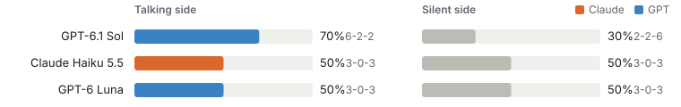

*Figure 12. Points won (1 for a win, ½ for a draw) by the talking and the silent side; each model plays itself, swapping sides every game.*

The results suggest that communication might help stronger models more than weaker ones. GPT-6.1 Sol's talking side won six of the eight games that had a winner, finishing with a record of 6–2–2 and outscoring its silent counterpart 10–6. Haiku and Luna, on the other hand, performed exactly as well with or without communication, each finishing 3–0–3. Of course, the sample is too small to draw strong conclusions. Even if communication had no effect, a split this lopsided in the talking side's favour would happen roughly one time in seven.

Still, communication isn't entirely useless for weaker teams. Haiku's tendency to send multiple players after the ball dropped from 62% to 45% when communication was enabled, even though this didn't translate into more wins. Simply giving agents the ability to talk doesn't guarantee they'll know how to use it.

### Does assigning a formation help?

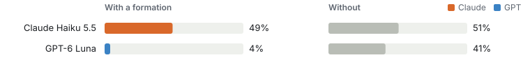

*Figure 13. Share of the opponent's possession ticks with two or more players heading for the ball, with and without a formation; each model plays itself.*

When given assigned areas of the pitch, Luna's players almost completely stop swarming the ball. The share of defensive ticks with multiple players chasing the ball drops from **41% to just 4%**, and the players spread out more than twice as far as before. Luna's structured team also beats its unstructured counterpart 3–1–2. Haiku shows a more mixed result. Its players spread out and become more likely to leave someone behind during attacks (4% → 15%), but they still frequently chase the ball (49%). The structured team doesn't win a single game, finishing 0–3–3.

These results suggest that weaker models can improve some aspects of their coordination when given explicit structure, but that structure doesn't necessarily translate into better performance. The stronger models appear more capable of organizing themselves without predefined roles, while weaker models benefit, at least in their positioning, from having those responsibilities specified.

## Limitations

- **Few games per model.** Due to cost, each model only played between 6 and 20 games, so the middle of the leaderboard is far from settled. Moreover, much of the analysis needs more experiments to tighten the confidence intervals. The additional experiments section used only 6–10 games per condition.

- **One environment and configuration.** The benchmark uses five-a-side soccer, providers' default reasoning effort, and communication delivered one tick later. Different rules, team sizes, or reasoning settings could change the results.

- **Heuristic coordination metrics.** The measurements of swarming and defensive positioning rely on distance thresholds extracted from the game logs.

## Next steps

- **Full eleven-a-side teams.** Does coordination improve or break down as the number of agents increases? Can models still spontaneously divide responsibilities when there are more players to coordinate?

- **More communication experiments.** In particular, I'd like to run more talking-versus-silent games with stronger models to determine whether communication genuinely improves performance.

- **Mixed-model teams.** The runner already supports teams composed of different models. Which models make good teammates? Can a stronger model help organize weaker agents, or does mixing communication styles make coordination harder?

- **More games and reasoning-effort sweeps.** Larger samples would help establish more reliable rankings, while varying reasoning effort could reveal whether additional individual reasoning translates into better collective behavior.